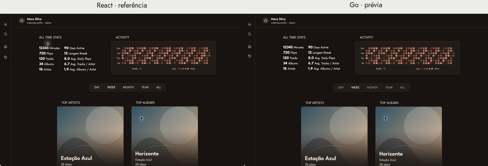
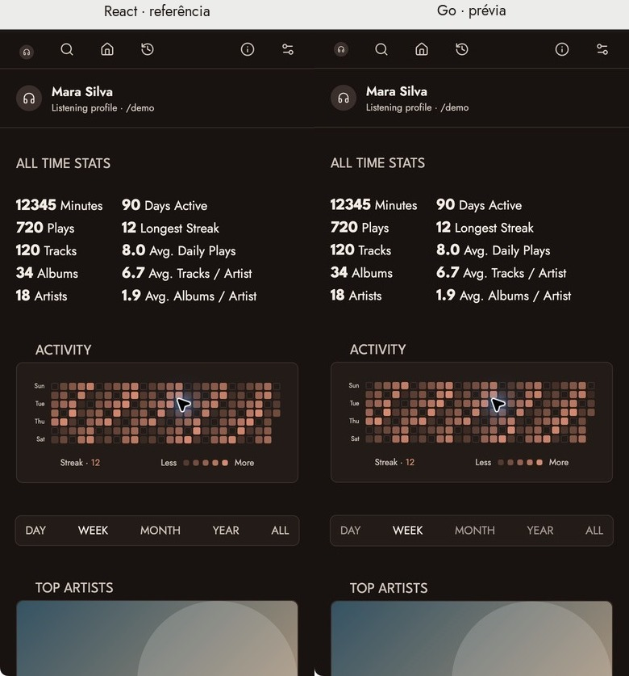
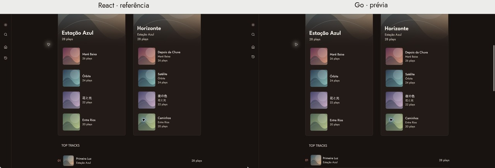
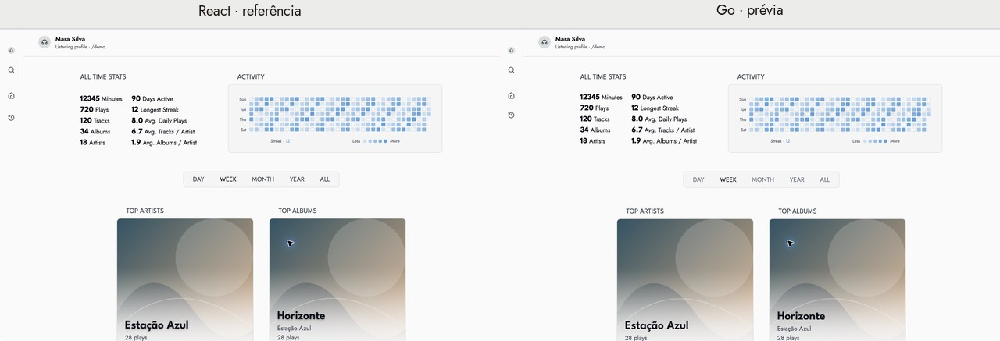
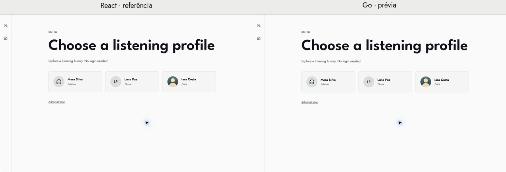
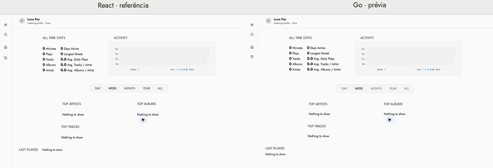

# Roadmap 1 — implementação e comparação visual

Data: **4 de novembro de 2026**. Referência: fontes locais da SPA, HEAD `72e4be2`,
compilados nesta execução. **Primeira prévia Go implementada e validada localmente.**
Integração com as páginas e os dados reais continua no passo 2. A revisão final
completa de paridade visual permanece pendente.

Issue: [001 — prévia Go, fechada e resolvida](<../../tasks/issue-001 - 001-—-Prévia-visual-da-interface-em-Go-roadmap-1.md>).
Plano: [análise do passo 1](<../../docs/roadmaps/doc-002 - Roadmap-1-—-layout-fontes-temas-barra-lateral-e-cards.md>).
Banco: **SQLite com esquema consolidado v3**, sem alterações nesta etapa.

## O que foi implementado

- Comando separado `cmd/ui-preview`, com portas exclusivamente de loopback e
  encerramento dos dois servidores por Ctrl+C. O padrão é 14111 para Go; a
  referência React opcional usa 14112. Nenhum dos dois abre o banco da aplicação.
- Pacote `internal/webui` com templates incorporados, CSS sem Tailwind/Vanilla
  Extract em runtime, 12 paletas equivalentes, ícones SVG e JavaScript local.
- Estrutura compartilhada, cabeçalho do perfil, rodapé, navegação desktop/móvel,
  seleção de perfis e avatares por ícone, iniciais e imagem fictícia.
- Destaques de artistas/álbuns, ranking, histórico, estatísticas, atividade e
  seletor de período, com fixtures visuais. As estatísticas não constituem um
  histórico real nem uma validação dos cálculos do backend.
- Aparência em Settings: temas, reset, edição de paleta hexadecimal, persistência
  local, abas por teclado, diálogo nativo, Escape e retorno do foco.
- Estados vazio, erro demonstrativo, títulos longos e imagens indisponíveis.
- `make ui.preview`, `make ui.check` e entrada em `CHANGELOG.md`.

Os perfis Mara Silva, Luna Paz e Iara Costa, as músicas e as imagens são fictícios.
Capas são os mesmos SVGs locais nas duas versões. Contagens e nomes vêm das mesmas
fixtures; a atividade se ancora na data de execução e os tempos recentes são
relativos, portanto capturas de dias diferentes não são diretamente equivalentes.
Apenas o perfil `demo` tem escutas; os outros dois demonstram o estado vazio.

## Comparação com screenshots

Chrome no macOS, escala de captura 2x. Foram solicitados viewports de 1280 × 1000
(desktop) e 390 × 844 (móvel) pela capacidade de viewport do navegador. As capturas
nativas registram a área visível da janela: os recortes publicados aqui mostram
**1280 × 801** e **390 × 801** pixels CSS, respectivamente. Não são capturas de
página inteira. Os pares usam a mesma largura e a mesma posição aproximada de
rolagem; as composições desktop reduzem cada lado para 640 px.

A interface de captura direta da aba falhou nesta sessão; foi usada a captura
nativa do Chrome. Os recortes removem a barra do navegador e outras abas. Só
foram feitos recorte, redução e composição com rótulos, sem alterar o conteúdo.
Originais ficam em `.local/roadmap-01-raw-screenshots/`, fora do versionamento.

Nas imagens, **React está à esquerda e Go à direita**.

### Home — tema Yuu





Foram ajustados durante a comparação: altura móvel da navegação, line-height do
slug, caixa alta dos títulos, largura do bloco superior, posição das células da
atividade e distribuição do seletor de períodos. A composição geral, fontes,
cores, bordas e gradientes ficaram próximas nos viewports registrados; isso não
é uma certificação de equivalência pixel a pixel.

### Cards — tema Yuu, região após rolagem



O primeiro item usa o mesmo destaque com gradiente; os seguintes usam miniaturas
de 90 px. Ranking e estatísticas continuam sem uma caixa externa de card.

### Tema claro Pearl



### Seleção de perfis e três tipos de avatar — Pearl



### Perfil vazio — Pearl



Diferença mantida e explícita: na SPA, o texto vazio de Last played aparece na
mesma linha do título; na prévia, aparece abaixo, como bloco de conteúdo.

### Aparência, telas estreitas e estados adicionais

- [Settings no celular](screenshots/go-settings-mobile.jpg)
- [Settings no desktop](screenshots/go-settings-desktop.jpg)
- [Go com 360 px de largura](screenshots/go-360-mobile.jpg)
- [Go com 400 px de largura](screenshots/go-400-mobile.jpg)
- [Nomes longos com 360 px](screenshots/go-long-360-mobile.jpg)
- [Imagens indisponíveis](screenshots/go-missing-images-desktop.jpg)
- [Erro demonstrativo](screenshots/go-error-desktop.jpg)

A inspeção das capturas de 360/390/400 px não mostrou conteúdo cortado
horizontalmente nos blocos registrados. Não houve medição automatizada de
`scrollWidth`, nem inspeção de todos os blocos abaixo da dobra em todas as larguras.

## Validação executada

| Verificação | Resultado |
| --- | --- |
| `make ui.check` | Passou: Go vet, testes Go da prévia/comando, sintaxe JS e três testes JS |
| `go test -race ./internal/webui ./cmd/ui-preview` | Passou |
| `CGO_ENABLED=0 go build -o .local/ui-preview ./cmd/ui-preview` | Passou; binário independente de libvips/Node |
| `CGO_ENABLED=1 go test ./... -timeout 60s` | Suíte completa passou; testes de integração autorizados a abrir portas locais |
| `cd client && corepack yarn run build` | Referência compilada com sucesso |
| `python3 scripts/version.py` | RC2 sincronizado após atualizar os caminhos dos documentos movidos |
| `git diff --check` | Passou; arquivos novos também foram revisados separadamente |

A primeira tentativa da suíte completa foi impedida pelo sandbox ao abrir uma
porta temporária; a repetição com a permissão de execução necessária passou.
Caches de build usados na verificação ficaram em `/private/tmp/` quando necessário.

Os testes da prévia verificam renderização, escape de nomes, fallback de tema,
rejeição de perfil desconhecido, rotas/artefatos de referência e recusa de escrita.
As paletas são comparadas propriedade por propriedade à fonte TypeScript.
Os testes JavaScript cobrem storage indisponível, JSON inválido, aplicação/reset
do tema personalizado e rejeição de propriedades/valores não permitidos.

Verificação no navegador:

- Todos os 12 temas responderam à seleção; registro em
  [theme-checks.json](theme-checks.json). Yuu e Pearl também têm pares de screenshots.
- Paleta `{}` foi rejeitada; uma paleta válida com principal `#66bbdd` foi aplicada
  e permaneceu após recarregar a página.
- Reset restaurou Yuu. Escape fechou Settings e devolveu foco ao botão Settings.
- O atalho `\` abriu Settings; Tab e seta para baixo selecionaram Account;
  seta para cima retornou a Appearance.
- Seleção de perfis, estados vazios, ícone/iniciais/imagem e fallback das capas
  foram inspecionados nas capturas. Erro de imagem de avatar não foi exercitado
  manualmente; o fallback existe no script.

## Diferenças e trabalho restante

- A prévia não consulta músicas reais. Links de mídia, busca, retrospectiva e
  administração abrem uma explicação; período altera apenas a seleção visual.
- Preservada a preferência de tema no navegador, sem cookie de perfil. O tema
  personalizado aceita as 14 propriedades com cores hexadecimais; outros formatos
  de cor que a SPA aceita informalmente não estão incluídos nesta prévia.
- Em telas muito estreitas, o CSS limita cards à largura disponível e distribui
  as opções de período. Isso evita copiar os mínimos rígidos que podem transbordar
  na SPA, mas exige comparação adicional nos limites dos breakpoints.
- Google Fonts ainda fornece Jost, League Spartan e Inter. Não foi feita troca
  pelas TTFs locais, que não contêm todos os pesos web usados. A referência React
  também mantém sua consulta pública de releases no GitHub.
- Falta a matriz completa de breakpoints da análise, desktop de 1536 px com três
  colunas, comparação detalhada em Black, rolagem de todas as regiões e validação
  de foco/teclado em todas as combinações. Não foi medido ganho de desempenho.
- A semântica real de calendário/fuso, preservação de filtros entre perfis,
  estatísticas e permissões deve ser integrada/testada nos passos seguintes.

A SPA, suas rotas públicas, a ingestão ListenBrainz e as migrações não foram
substituídas. Nenhum banco em uso foi iniciado ou modificado pela prévia. Nenhuma
issue, branch, imagem ou release foi publicada; nenhum commit foi criado.

## Como reproduzir

Na raiz, com Go instalado:

```sh
make ui.preview
```

Abra `http://127.0.0.1:14111/`. Para comparar com React:

```sh
cd client
corepack yarn run build
cd ..
go run ./cmd/ui-preview -reference 127.0.0.1:14112
```

Abra as mesmas rotas nas duas portas. Selecione o mesmo tema em Settings em cada
origem, use o mesmo viewport, aguarde fontes/imagens e compare a mesma região.
As preferências de aparência de cada porta são independentes. Encerre com Ctrl+C.
Templates e estáticos são incorporados; reinicie o comando após alterá-los.

Na sessão que produziu este relatório, os servidores de validação foram encerrados
ao concluir. O comando de prévia fica disponível para a próxima revisão.
