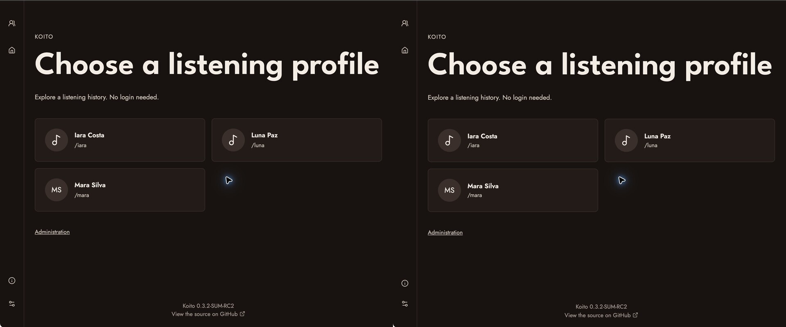

# Roadmap 2 — implementação e comparação React/Go

Concluído em 4 de novembro de 2026, na sequência **003 → 004 → 005**.
As três issues locais estão fechadas e resolvidas. O modo Go está disponível
por opção de configuração; React continua sendo o padrão da instalação.
**Banco vigente: SQLite, esquema consolidado v3, sem nova migração.**

## Entrega

A seleção de perfis, home, três rankings e histórico agora podem ser renderizados
por Go com os dados reais. Cada requisição resolve o slug e aplica o ID do perfil
antes das leituras; a seleção permanece explícita mesmo com um único perfil.
`internal/listening/` compartilha estatísticas, atividade e tocando agora com a
API; `internal/webquery/` concentra parâmetros e fusos; `internal/webui/` contém
handlers, modelos, templates e assets. A prévia fictícia do passo 1 segue isolada.

A home conserva estatísticas gerais e últimas 28 escutas em all_time, atividade
de 252 dias, cinco artistas, cinco álbuns e dez faixas por período. Preferência
de período usa o ID estável do perfil; a URL explícita prevalece. Falhas de um
bloco aparecem como indisponibilidade, sem inventar zeros. Sem JS, as leituras e
os formulários GET continuam funcionando; aparência, detecção de fuso e ações
administrativas usam JavaScript pequeno. Dados atualizam por navegação/recarga.

Paginação usa base 1; `page=0` normaliza para 1, negativos/overflow e filtros HTML
inválidos retornam 400. Rankings mantêm os empates de `RANK()`. Histórico desempata
por faixa no mesmo segundo e propaga falhas da contagem. Rótulos de datas usam o
intervalo consultado; a API ganhou metadados aditivos `range`. Limites móveis são
resolvidos uma vez por leitura. Fuso mantém a precedência forçado → query → cookie
→ servidor; atividade mantém o fallback UTC da API quando o nome é `Local`.

`KOITO_WEB_UI=go` ativa as páginas; `react` restaura a interface anterior após
reiniciar. A SPA continua necessária para artistas, álbuns, faixas, rewind e
administração. Uma ponte baseada na localização React força navegação completa
para páginas Go, incluindo links e histórico do navegador. URLs legadas conhecidas
resolvem um perfil único ou levam à seleção com `next` interno validado.
Aparência, busca por perfil e acesso à administração estão funcionais. Exclusão
usa o endpoint existente com sessão, faixa e segundo, seguido de recarga.

## Ambiente e método das capturas

As capturas usam **duas cópias equivalentes de um SQLite v3 descartável**, criadas
por `scripts/validate_webui.py`. Mara tem 152 escutas, 60 faixas, cinco álbuns e
cinco artistas; Luna tem uma faixa exclusiva; Iara não tem escutas. As capas são
arte local de teste enviada pelo endpoint real, iguais entre as duas cópias.
Nenhum banco de usuário foi aberto ou alterado para estes testes.

Chrome no macOS, tema Yuu e fuso forçado `America/Sao_Paulo`. Desktop: viewport
960 × 800; celular: 390 × 844. Captura nativa em escala 2, recortada para remover
abas e barras do navegador e reduzida à escala CSS. O registro móvel mostra os
primeiros 800 px visíveis. São capturas de viewport, não de página inteira.
[Manifesto](screenshots.json) registra URLs e dimensões; [resultado HTTP](validation.json)
registra a execução final do servidor. Horários relativos podem variar entre pares.

Em todos os pares: **React à esquerda; Go à direita**.

| Cenário | Evidência |
| --- | --- |
| Seleção de três perfis | [Desktop](screenshots/comparison-selection.jpg) · [Celular](screenshots/comparison-mobile-selection.jpg) |
| Home e estatísticas | [Desktop](screenshots/comparison-home.jpg) · [Celular](screenshots/comparison-mobile-home.jpg) |
| Artistas, com empates | [Comparação](screenshots/comparison-artists.jpg) |
| Álbuns | [Comparação](screenshots/comparison-albums.jpg) |
| Faixas | [Comparação](screenshots/comparison-tracks.jpg) |
| Histórico, página 2 (52 registros) | [Desktop](screenshots/comparison-history-page-2.jpg) · [Celular](screenshots/comparison-mobile-history.jpg) |
| Histórico filtrado por mês/artista | [Comparação](screenshots/comparison-history-filter.jpg) |
| Perfil vazio | [Comparação](screenshots/comparison-empty.jpg) |
| Artista React no modo Go | [Captura](screenshots/mixed-react-media.jpg) |
| Retorno pela Home para Go | [Captura](screenshots/mixed-return-go.jpg) |
| Histórico Go com sessão admin | [Captura](screenshots/go-admin-history.jpg) |



## Resultado da inspeção visual

Fontes, paleta, identificação do perfil, barra lateral e cards conservam a base
do passo 1. Os números e a ordem dos registros coincidem nos pares. Empates dos
artistas aparecem como 1, 1, 3, 3, 3; a página 2 começa pela mesma faixa/instante.
Em 390 px a navegação fica no topo e os filtros quebram linha sem corte lateral.

Há diferenças visuais conhecidas: listagens Go ocupam mais largura, usam formulário
GET com botão Apply e número da página, em vez dos seletores imediatos React;
o gradiente extraído da capa nos rankings React ainda não foi reproduzido.
Espaçamentos e setas nos títulos da home também diferem levemente. Estes pares
registram equivalência funcional; não representam aprovação de paridade pixel a
pixel. A matriz visual mais ampla do passo 1 continua descrita no relatório anterior.

## Validação

- `make check ui.check`: vet, suíte Go, typecheck, oito testes do cliente e três
  testes de tema, além da sintaxe dos scripts da interface.
- `go test -race ./internal/webui ./internal/webquery ./internal/listening ./internal/db/sqlite`:
  sem condições de corrida detectadas nos pacotes exercitados.
- Build de produção React e binário Go concluídos.
- `validate_webui.py`: páginas HTTP reais, HTML/API, 52 registros na página 2,
  filtros inválidos, 404, busca isolada, SPA preservada, chave de player recusada
  para exclusão, origem externa recusada, sessão admin aceita e registro restaurado.
  Integridade/FKs verificadas; versão máxima aplicada do esquema = 3.
- `validate_multiuser.py`: regressão com bancos descartáveis novo e migrado,
  ingestão, isolamento e administração. Resultado em [multiuser-validation.json](multiuser-validation.json).
- Navegador: acesso direto, seleção, troca de perfil, busca, aparência e link de
  administração; login no admin React e botões de exclusão no histórico Go;
  artista React → Home Go, voltar/avançar sem loop; abas Mara (152) e Luna (1)
  mantiveram seus destinos independentemente. A exclusão foi executada/restaurada
  pelo teste HTTP; no navegador foi conferida a disponibilidade do controle.
- Testes focados cobrem HTML escapado, perfis vazios, 404 versus falha de banco,
  múltiplos artistas/compilações, tocando agora por perfil, empate no mesmo segundo,
  contagem cancelada, ISO 1/2026, ano bissexto, DST e precedência do fuso forçado.

Não foi medido ganho de desempenho. Offset não garante snapshot diante de novas
escutas concorrentes. Google Fonts e a consulta pública de releases da SPA seguem
existentes. A remoção de React e a migração das páginas restantes pertencem aos
próximos passos. Nenhum commit, push ou publicação foi realizado.

## Reproduzir

Com as dependências locais já instaladas, na raiz:

```sh
make check ui.check
make client.build api.build
python3 scripts/validate_webui.py --binary ./koito --work-dir .local/webui-new-run --serve --go-port 14121 --react-port 14122
```

`--work-dir` deve ser novo a cada execução. O script ignora variáveis KOITO herdadas,
usa credenciais de teste e desativa provedores musicais externos. Os dois endereços
são impressos sem segredos. Compare as mesmas URLs do manifesto. Ctrl+C encerra
os servidores; bancos/logs ficam em `.local/`, fora do versionamento. Sem `--serve`,
a validação encerra automaticamente. Os processos usados nas capturas foram
encerrados ao concluir esta sessão.
